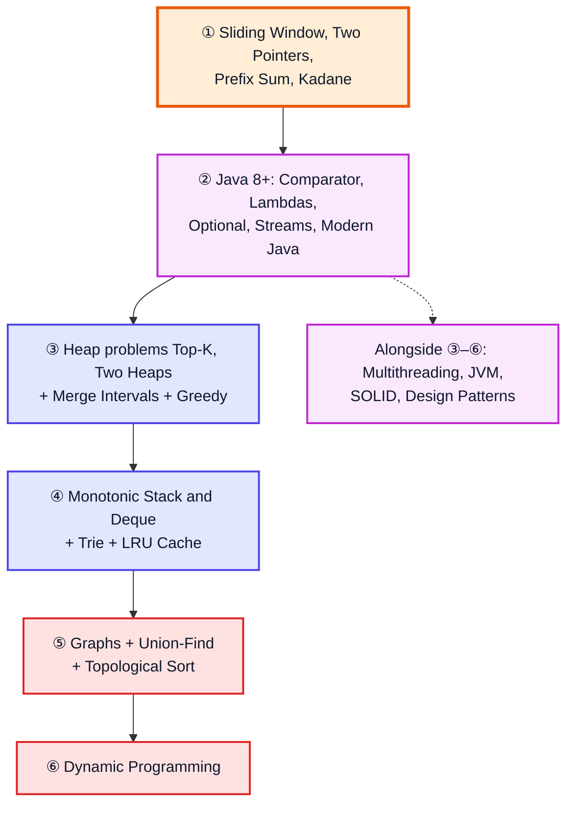

# Topics Not Covered — Java & DSA Gap List

**What this is:** Java and DSA topics that are **not taught** in Kunal Kushwaha's *Java + DSA + Interview Preparation Course* playlist (69 videos). The list comes from what the 66 video notes in [`kunal-java-notes-claude/`](kunal-java-notes-claude/) cover (videos 4–69). Every topic now has its own notes file, linked in the **Notes** column.

> [!NOTE]
> Kunal may teach some of these in other videos or courses. They just aren't in **this playlist**.
> - Java gap notes: [`Java Topics Not Covered Notes/`](Java%20Topics%20Not%20Covered%20Notes/)
> - DSA gap notes: [`DSA Topics Not Covered Notes/`](DSA%20Topics%20Not%20Covered%20Notes/)
> - The order to study everything in (playlist videos and gap topics together): [java_dsa_study_roadmap.md](java_dsa_study_roadmap.md)

**Priority:** 🔴 asked very often in interviews · 🟡 useful · 🟢 nice to know

---

## Table of Contents

| # | Section |
|---|---|
| 1 | [Java Gaps](#1-java-gaps) |
| 2 | [DSA: Whole Topics Missing](#2-dsa-whole-topics-missing) |
| 3 | [DSA: Missing Patterns](#3-dsa-missing-patterns) |
| 4 | [Recommended Study Order](#4-recommended-study-order) |
| 5 | [Checklist](#5-checklist) |

---

## 1. Java Gaps

| Topic | Priority | Why it matters / what's missing | Notes |
|---|---|---|---|
| **Multithreading & Concurrency**: Thread, Runnable, `synchronized`, `volatile`, ExecutorService, CompletableFuture, locks, race conditions, deadlock | 🔴 | A favourite topic in Java interviews. Only Vector's thread safety is touched ([video 43][v43]). | [Java #1][j01] |
| **Streams API in depth**: `map`, `filter`, `reduce`, `collect`, `groupingBy`, `flatMap`, parallel streams | 🔴 | Lambdas are covered ([video 42][v42]), but streams aren't really taught. | [Java #2][j02] |
| **Comparator & Comparable in depth**: `Comparator.comparing`, `thenComparing`, custom sorting | 🔴 | Needed for sorting objects and for PriorityQueue problems. | [Java #3][j03] |
| **Design Patterns**: Factory, Builder, Observer, Strategy, Decorator… | 🟡 | Only Singleton is covered ([video 38][v38]). | [Java #4][j04] |
| **SOLID principles / low-level design** | 🟡 | Asked in design rounds. | [Java #5][j05] |
| **Functional interfaces & `Optional`**: Supplier, Consumer, Predicate, Function | 🟡 | Used everywhere in modern Java code. | [Java #6][j06] |
| **Modern Java features**: records, sealed classes, `var`, text blocks, switch pattern matching, virtual threads | 🟡 | The course uses older Java. The video notes mention some of these only in passing. | [Java #7][j07] |
| **Generics in depth**: wildcards `? extends` / `? super`, type erasure, bounded types | 🟡 | [Video 42][v42] only covers the basics. | [Java #8][j08] |
| **JVM internals**: memory model, GC algorithms and tuning, class loading in depth | 🟡 | [Video 7][v07] is introductory only. | [Java #9][j09] |
| **Iterator / Iterable**, fail-fast vs fail-safe iterators | 🟡 | A common question about collections. | [Java #10][j10] |
| Serialization, Reflection, Regex, Date/Time API (`java.time`) | 🟢 | Practical, but less often asked. | [Java #11][j11] |
| Unit testing (JUnit), build tools (Maven/Gradle), JDBC | 🟢 | Real-world development rather than interview topics. | [Java #12][j12] |

---

## 2. DSA: Whole Topics Missing

| Topic | Priority | What's missing | Notes |
|---|---|---|---|
| **Dynamic Programming** | 🔴 | All of it: memoization vs tabulation, 1D DP (climbing stairs, house robber), 0/1 and unbounded knapsack, LIS, LCS, edit distance, grid DP, partition DP, DP on trees, bitmask DP. Only the memoized dice solution in [video 34][v34] comes close. | [DSA topic #1][t01] |
| **Graphs** | 🔴 | Representing a graph (adjacency list/matrix), BFS/DFS on graphs, connected components, cycle detection, **topological sort**, **Dijkstra**, Bellman-Ford, Floyd-Warshall, **MST** (Prim/Kruskal), bipartite check, SCC, bridges. Only [Word Ladder (video 65)][v65] touches this. | [DSA topic #2][t02] |
| **Union-Find (DSU)** | 🔴 | Union by rank, path compression, connected-component problems. | [DSA topic #3][t03] |
| **Trie** | 🔴 | Insert and search, prefix search, Word Search II, autocomplete. | [DSA topic #4][t04] |

---

## 3. DSA: Missing Patterns

| Pattern | Priority | Typical problems | Notes |
|---|---|---|---|
| **Sliding Window** (fixed and variable size) | 🔴 | Longest Substring Without Repeating Characters (LC 3), Minimum Window Substring (LC 76), max sum subarray of size k | [DSA gap #1][d01] |
| **Two Pointers on arrays** | 🔴 | 3Sum (LC 15), Container With Most Water (LC 11), Trapping Rain Water (LC 42), sorted Two Sum (LC 167) | [DSA gap #2][d02] |
| **Prefix Sum / Difference Array** | 🔴 | Subarray Sum Equals K (LC 560), Range Sum Query (LC 303), Product of Array Except Self (LC 238) | [DSA gap #3][d03] |
| **Kadane's Algorithm** | 🔴 | Maximum Subarray (LC 53), Maximum Sum Circular Subarray (LC 918) | [DSA gap #4][d04] |
| **Merge Intervals** | 🔴 | Merge Intervals (LC 56), Insert Interval (LC 57), Meeting Rooms (LC 252/253) | [DSA gap #5][d05] |
| **Top-K / K-way Merge** with heaps | 🔴 | Kth Largest Element (LC 215), Top K Frequent (LC 347), Merge K Sorted Lists (LC 23). [Video 56][v56] teaches heaps but doesn't solve these. | [DSA gap #6][d06] |
| **Two Heaps** | 🟡 | Find Median from Data Stream (LC 295), Sliding Window Median (LC 480) | [DSA gap #7][d07] |
| **Monotonic Stack in depth** | 🟡 | Next Greater Element (LC 496/503), Daily Temperatures (LC 739), Online Stock Span (LC 901). Only the histogram problem is in [video 47][v47]. | [DSA gap #8][d08] |
| **Monotonic Deque** | 🟡 | Sliding Window Maximum (LC 239) | [DSA gap #9][d09] |
| **Greedy in general** | 🟡 | Jump Game (LC 55/45), Gas Station (LC 134), activity selection, interval scheduling. Only [Huffman coding (video 61)][v61] is covered. | [DSA gap #10][d10] |
| **Matrix traversal** | 🟡 | Spiral Matrix (LC 54), Rotate Image (LC 48), Set Matrix Zeroes (LC 73), Flood Fill / Number of Islands (LC 733/200) | [DSA gap #11][d11] (flood fill and islands: [topic #2, §5][t02grid]) |
| **Combination-style backtracking** | 🟡 | Combination Sum (LC 39/40), Word Search (LC 79), Palindrome Partitioning (LC 131) | [DSA gap #12][d12] |
| **System-design data structures** | 🟡 | LRU Cache (LC 146), LFU Cache (LC 460) | [DSA gap #13][d13] |
| **String algorithms** | 🟢 | KMP, Z-algorithm, Manacher. Only [Karp-Rabin (video 58)][v58] is covered. | [DSA gap #14][d14] |
| **Advanced range-query structures** | 🟢 | Fenwick tree (BIT), segment tree with lazy propagation, sparse table | [DSA gap #15][d15] |
| **Maths extras** | 🟢 | Fast power, modular inverse, nCr, combinatorics | [DSA gap #16][d16] |

---

## 4. Recommended Study Order

The full, step-by-step order (mixing playlist videos and gap topics, with the reason for every position) is in **[java_dsa_study_roadmap.md](java_dsa_study_roadmap.md)**. This is the short version for someone who has **already finished the playlist** and wants the most interview value:

| Step | Why this order |
|---|---|
| ① Array and string patterns | Quick to learn, asked constantly, and they only need arrays, strings and a `HashMap`. |
| ② Java 8+ features | Easier than the remaining DSA, needed for Java rounds, and used by the code in the later steps (comparators in heaps, records as map keys). |
| ③ Heaps, intervals, greedy | Build on the heap from [video 56][v56] and sorting with comparators. Greedy comes before graphs because Dijkstra, Prim and Kruskal are greedy. |
| ④ Stacks, deques, tries, caches | Medium-frequency patterns; they build on [videos 44–49][v44] and hashing. |
| ⑤ Graphs | A direct extension of the tree BFS/DFS from [video 55][v55]. |
| ⑥ Dynamic Programming | The biggest and hardest gap, so it comes last. It builds on the recursion videos (23, 27–36). If an interview is close and you can only learn one topic, learn DP. |
| Advanced Java alongside | No DSA topic depends on it; one or two sessions a week from step ② onward. |

> [!NOTE]
> An earlier version of this file put DP second, ranking topics by how often they come up in interviews. The order above follows prerequisites instead, and matches the roadmap.

---

## 5. Checklist

Tick these off as you learn them.

**Java**
- [ ] Multithreading & Concurrency — [notes][j01]
- [ ] Streams API — [notes][j02]
- [ ] Comparator & Comparable — [notes][j03]
- [ ] Design Patterns — [notes][j04]
- [ ] SOLID / Low-level design — [notes][j05]
- [ ] Functional interfaces & `Optional` — [notes][j06]
- [ ] Modern Java (records, sealed classes, pattern matching, virtual threads) — [notes][j07]
- [ ] Generics wildcards & type erasure — [notes][j08]
- [ ] JVM internals & GC — [notes][j09]
- [ ] Iterator, fail-fast vs fail-safe — [notes][j10]
- [ ] Serialization, Reflection, Regex, `java.time` — [notes][j11]
- [ ] JUnit, Maven/Gradle, JDBC — [notes][j12]

**DSA**
- [ ] Dynamic Programming — [notes][t01]
- [ ] Graphs (BFS/DFS, topological sort, Dijkstra, MST) — [notes][t02]
- [ ] Union-Find — [notes][t03]
- [ ] Trie — [notes][t04]
- [ ] Sliding Window — [notes][d01]
- [ ] Two Pointers (arrays) — [notes][d02]
- [ ] Prefix Sum / Difference Array — [notes][d03]
- [ ] Kadane's Algorithm — [notes][d04]
- [ ] Merge Intervals — [notes][d05]
- [ ] Top-K / K-way Merge — [notes][d06]
- [ ] Two Heaps — [notes][d07]
- [ ] Monotonic Stack & Deque — [stack][d08], [deque][d09]
- [ ] Greedy — [notes][d10]
- [ ] Matrix traversal — [notes][d11]
- [ ] Combination backtracking — [notes][d12]
- [ ] LRU / LFU Cache — [notes][d13]
- [ ] KMP / Z / Manacher — [notes][d14]
- [ ] Fenwick tree, lazy segment tree, sparse table — [notes][d15]
- [ ] Maths extras (fast power, modular inverse, nCr) — [notes][d16]

[v07]: kunal-java-notes-claude/java_07_video_java_architecture.md
[v34]: kunal-java-notes-claude/java_34_video_recursion_dice_phone_letters.md
[v38]: kunal-java-notes-claude/java_38_video_oop_static_packages_singleton.md
[v42]: kunal-java-notes-claude/java_42_video_generics_lambdas_exceptions_cloning.md
[v43]: kunal-java-notes-claude/java_43_video_collections_vector_enums.md
[v44]: kunal-java-notes-claude/java_44_video_linked_list.md
[v47]: kunal-java-notes-claude/java_47_video_stack_queue_questions.md
[v55]: kunal-java-notes-claude/java_55_video_binary_tree_questions.md
[v56]: kunal-java-notes-claude/java_56_video_heaps_priority_queue.md
[v58]: kunal-java-notes-claude/java_58_video_karp_rabin.md
[v61]: kunal-java-notes-claude/java_61_video_huffman_coding.md
[v65]: kunal-java-notes-claude/java_65_video_word_ladder.md
[j01]: Java%20Topics%20Not%20Covered%20Notes/java_gap_01_multithreading_concurrency.md
[j02]: Java%20Topics%20Not%20Covered%20Notes/java_gap_02_streams_api.md
[j03]: Java%20Topics%20Not%20Covered%20Notes/java_gap_03_comparator_comparable.md
[j04]: Java%20Topics%20Not%20Covered%20Notes/java_gap_04_design_patterns.md
[j05]: Java%20Topics%20Not%20Covered%20Notes/java_gap_05_solid_low_level_design.md
[j06]: Java%20Topics%20Not%20Covered%20Notes/java_gap_06_functional_interfaces_optional.md
[j07]: Java%20Topics%20Not%20Covered%20Notes/java_gap_07_modern_java_features.md
[j08]: Java%20Topics%20Not%20Covered%20Notes/java_gap_08_generics_in_depth.md
[j09]: Java%20Topics%20Not%20Covered%20Notes/java_gap_09_jvm_internals_gc.md
[j10]: Java%20Topics%20Not%20Covered%20Notes/java_gap_10_iterator_fail_fast_fail_safe.md
[j11]: Java%20Topics%20Not%20Covered%20Notes/java_gap_11_serialization_reflection_regex_time.md
[j12]: Java%20Topics%20Not%20Covered%20Notes/java_gap_12_junit_maven_gradle_jdbc.md
[t01]: DSA%20Topics%20Not%20Covered%20Notes/dsa_topic_01_dynamic_programming.md
[t02]: DSA%20Topics%20Not%20Covered%20Notes/dsa_topic_02_graphs.md
[t02grid]: DSA%20Topics%20Not%20Covered%20Notes/dsa_topic_02_graphs.md#5-grid-graphs-islands-flood-fill-rotting-oranges
[t03]: DSA%20Topics%20Not%20Covered%20Notes/dsa_topic_03_union_find.md
[t04]: DSA%20Topics%20Not%20Covered%20Notes/dsa_topic_04_trie.md
[d01]: DSA%20Topics%20Not%20Covered%20Notes/dsa_gap_01_sliding_window.md
[d02]: DSA%20Topics%20Not%20Covered%20Notes/dsa_gap_02_two_pointers.md
[d03]: DSA%20Topics%20Not%20Covered%20Notes/dsa_gap_03_prefix_sum_difference_array.md
[d04]: DSA%20Topics%20Not%20Covered%20Notes/dsa_gap_04_kadanes_algorithm.md
[d05]: DSA%20Topics%20Not%20Covered%20Notes/dsa_gap_05_merge_intervals.md
[d06]: DSA%20Topics%20Not%20Covered%20Notes/dsa_gap_06_top_k_k_way_merge.md
[d07]: DSA%20Topics%20Not%20Covered%20Notes/dsa_gap_07_two_heaps.md
[d08]: DSA%20Topics%20Not%20Covered%20Notes/dsa_gap_08_monotonic_stack.md
[d09]: DSA%20Topics%20Not%20Covered%20Notes/dsa_gap_09_monotonic_deque.md
[d10]: DSA%20Topics%20Not%20Covered%20Notes/dsa_gap_10_greedy.md
[d11]: DSA%20Topics%20Not%20Covered%20Notes/dsa_gap_11_matrix_traversal.md
[d12]: DSA%20Topics%20Not%20Covered%20Notes/dsa_gap_12_combination_backtracking.md
[d13]: DSA%20Topics%20Not%20Covered%20Notes/dsa_gap_13_lru_lfu_cache.md
[d14]: DSA%20Topics%20Not%20Covered%20Notes/dsa_gap_14_string_algorithms.md
[d15]: DSA%20Topics%20Not%20Covered%20Notes/dsa_gap_15_range_query_structures.md
[d16]: DSA%20Topics%20Not%20Covered%20Notes/dsa_gap_16_maths_extras.md
